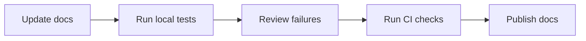

## Overview

TWU Doc Detective helps you keep documentation accurate as product behavior changes. You can use it to validate docs locally before you publish, run checks in CI/CD, and automate repeatable tests for CLI commands, API calls, and UI steps.

This guide is a starter kit template. Adapt the examples to your own product, routes, and test data while keeping the workflow the same.

<Callout kind="info">

Use a small, repeatable test suite first, then expand it as your docs grow. That keeps maintenance manageable and makes failures easier to triage.

</Callout>

## Common testing workflows

<Columns cols={3}>
  <Card title="Local validation" icon="terminal" href="#local-validation-before-publishing">
    Run tests on your machine before you publish changes.
  </Card>
  <Card title="CI/CD pipelines" icon="cloud" href="#running-tests-in-ci-cd-pipelines">
    Catch broken steps automatically on every pull request.
  </Card>
  <Card title="Reusable test packs" icon="book-open" href="#organizing-tests-for-repeatable-updates">
    Group related checks so you can rerun them after each release.
  </Card>
</Columns>

### Workflow map



## Local validation before publishing

You should validate important pages locally before you send a change for review. This is the fastest way to catch broken commands, outdated screenshots, and copy that no longer matches the product.

Use local validation when you are changing onboarding flows, API examples, or navigation steps that readers follow in order.

<Steps>
  <Step title="Install the test runner" icon="download">

Use the package manager you already use for the repository:

````bash
npm install -D doc-detective
````

  </Step>
  <Step title="Create a workflow file" icon="settings">

Define the pages and interactions you want to verify. Keep the first version short and focused on high-value tasks.

````yaml
name: onboarding-checks
steps:
  - open: https://docs.example.com/get-started
  - click: "Install"
  - expect: "npm install doc-detective"
````

  </Step>
  <Step title="Run the workflow" icon="play-circle">

Execute the checks and review the output. Fix the content if a command, label, or UI state no longer matches.

````bash
npx doc-detective run workflows/onboarding-checks.yml
````

  </Step>
</Steps>

<Callout kind="tip">

If a page changes often, split it into smaller workflows. Short tests are easier to debug and faster to rerun.

</Callout>

## Running tests in CI/CD pipelines

CI is the best place to enforce documentation quality on every change. When you run tests in a pipeline, you stop broken instructions from shipping with the site.

A good CI job does three things: installs dependencies, runs the workflow suite, and uploads artifacts such as screenshots or logs when a step fails.

<CodeGroup tabs="GitHub Actions,Bash">
  ```yaml
  name: Docs validation
  on:
    pull_request:
  jobs:
    test-docs:
      runs-on: ubuntu-latest
      steps:
        - uses: actions/checkout@v4
        - uses: actions/setup-node@v4
          with:
            node-version: 20
        - run: npm ci
        - run: npx doc-detective run workflows/*.yml
  ```
  ```bash
  npm ci
  npx doc-detective run workflows/*.yml
  ```
</CodeGroup>

### Recommended pipeline behavior

| Step | Purpose | Result |
|------|---------|--------|
| Install dependencies | Prepare a clean environment | Reproducible runs |
| Execute workflows | Verify docs behavior | Pass or fail status |
| Store artifacts | Capture screenshots and logs | Easier debugging |
| Block merge on failure | Protect published docs | Higher trust in docs |

## Testing CLI commands, API calls, and UI steps

Doc checks often span more than one surface. A reliable workflow can verify a command in the terminal, confirm an API response, and then check that the UI reflects the same result.

Use the right test style for each surface:

<Tabs>
  <Tab title="CLI" icon="terminal">

````bash
doc-detective test cli --command "twu docs build --site docs"
````

Use CLI tests to confirm command names, flags, exit codes, and output text.

  </Tab>
  <Tab title="API" icon="database">

````bash
curl -s https://api.example.com/v1/status
````

Use API checks when a page depends on a live response, such as a status badge or data summary.

  </Tab>
  <Tab title="UI" icon="monitor">

````bash
npx doc-detective run workflows/ui-walkthrough.yml
````

Use UI checks for buttons, forms, menus, and page content that readers must interact with.

  </Tab>
</Tabs>

## Automating screenshot capture

Screenshots help you verify that a page still looks the way you expect after a layout change. They are especially useful for onboarding guides, settings pages, and product tours.

You do not need to capture every page. Focus on the screenshots that help you detect visual regressions quickly.

<CodeGroup tabs="YAML,JSON">
  ```yaml
  screenshots:
    enabled: true
    path: artifacts/screenshots
    viewport:
      width: 1440
      height: 900
  ```
  ```json
  {
    "screenshots": {
      "enabled": true,
      "path": "artifacts/screenshots",
      "viewport": {
        "width": 1440,
        "height": 900
      }
    }
  }
  ```
</CodeGroup>

<Callout kind="alert">

Keep your screenshot baseline current. If the page design changes intentionally, update the saved images so future test runs do not report false failures.

</Callout>

## Organizing tests for repeated documentation updates

As your docs grow, structure tests around topics instead of one-off pages. That way, you can reuse them when the same feature appears in multiple places.

A simple pattern is to group tests by audience or task:

<Expandable title="How to structure reusable test packs" default-open="true">

Use folders such as `getting-started`, `api-reference`, and `admin-workflows`. Inside each folder, keep one file per task, not one file per page.

For example:

- `workflows/getting-started/install.yml`
- `workflows/getting-started/first-request.yml`
- `workflows/api-reference/auth.yml`

That structure makes updates predictable when you rename a page or change a button label.

</Expandable>

<Expandable title="When to split a workflow into smaller files" default-open="false">

Split a workflow when it starts to do too much. If a single file checks setup, navigation, and multiple features, it becomes hard to debug.

A smaller workflow is better when:

- one failure prevents the rest of the checks from running
- multiple teams maintain different sections
- one page changes more often than the others

</Expandable>

## Best practices for accuracy over time

Keep your documentation tests focused on the user actions that matter most. A short set of reliable checks is better than a huge suite that nobody maintains.

A few habits make the workflow easier to sustain:

1. Test the most important paths first.
2. Use stable labels in your docs when possible.
3. Update screenshots and expected output as part of the same pull request.
4. Review failures promptly so the suite stays trustworthy.
5. Reuse test files for recurring updates, such as new examples or renamed menus.

<Callout kind="success">

When you build workflows around real user tasks, you catch problems earlier and make your docs easier to trust.

</Callout>

## Next steps

Start with one workflow that covers a high-value page. Then add CI enforcement, API checks, and screenshot capture as your documentation process matures.

<Columns cols={2}>
  <Card title="Quickstart" icon="rocket" href="/quickstart" horizontal>
    Set up your first validation flow in a few minutes.
  </Card>
  <Card title="Authentication" icon="shield" href="/authentication" horizontal>
    Learn how to secure access to your testing environment.
  </Card>
</Columns>